  

  <b>公立はこだて未来大学（FUN）の生協食堂の混雑状況と待ち時間を見える化するプロジェクト</b>

---

## 🍚 FUNavi とは

昼休みなどに利用者が集中する生協食堂の混雑を、データで見える化するプロジェクトです。
食堂に並んでいる人数と時間帯を集め、メニューや講義の時間割と合わせて分析し、待ち時間を予測して表示することで、利用の集中を分散させることを目指しています。

- 🕐 **混雑状況・待ち時間の表示**：今どのくらい混んでいるか、どのくらい待つかがわかる
- 📊 **混みやすい時間帯の表示**：空いている時間を選んで食堂に行ける
- 📦 **出食数の推定（将来）**：生協の仕入れの参考にしてもらう

## 📁 リポジトリ

| リポジトリ | 内容 |
| --- | --- |
| [FUNavi](https://github.com/fun-funavi/FUNavi) | プロジェクトの説明・資料 |

## 🚧 現在の状況

高度ICT演習の新テーマとして準備中です。現在は事前活動として、食堂の様子の撮影と分析の準備を進めています。

## 🔒 プライバシーについて

撮影データは高度ICT演習の活動にのみ使用し、関係者以外がアクセスできない場所で管理します。保存期間は1年程度とし、期間終了後に削除します。

## 🤝 協力

公立はこだて未来大学 大学生協

---

  公立はこだて未来大学 高度ICT演習

